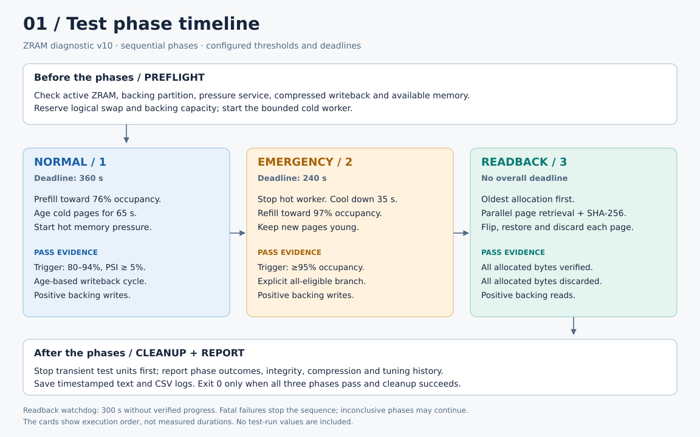
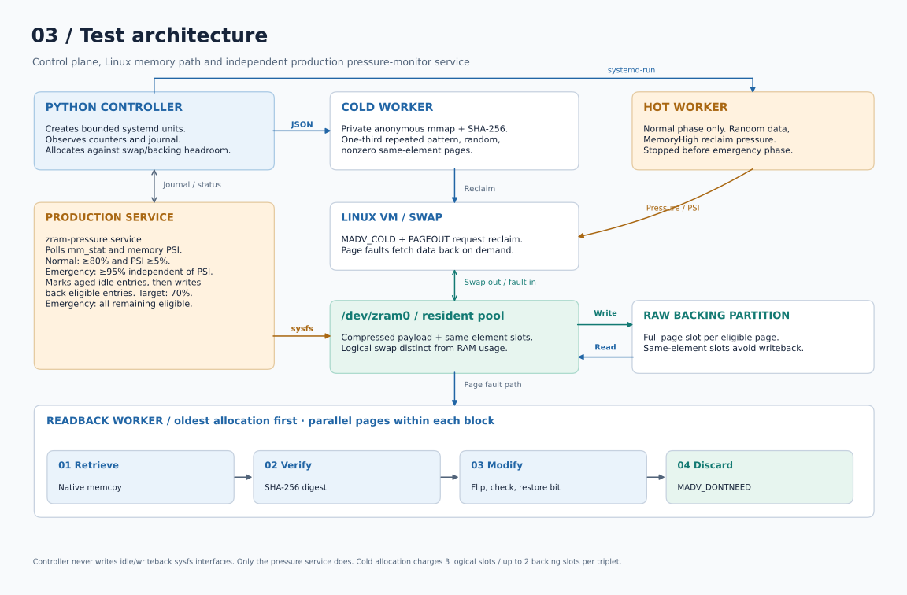
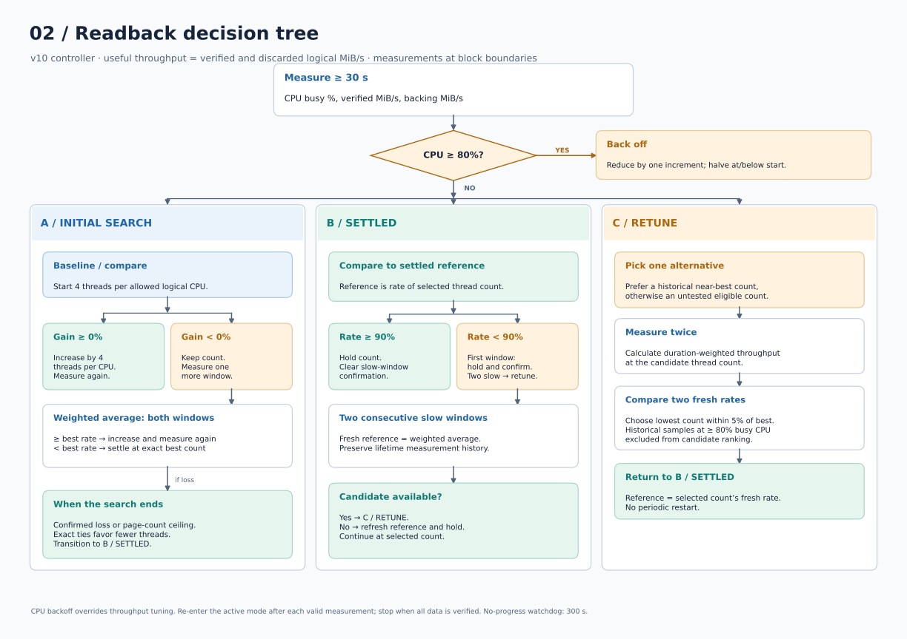
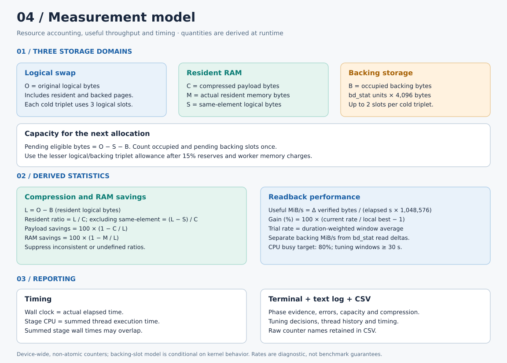

# ZRAM writeback diagnostic — `test_zram.py`

[Back to chapter 06 — ZSTD ZRAM with SSD writeback](README.md) · [Python source](files/test_zram.py) · [Pressure monitor](files/zram-pressure.sh)

**Scope:** This is the operating and technical reference for the standalone v10 diagnostic. It is not an installation procedure, a persistent service, or a storage benchmark. It documents the script's behavior, not results from any particular test run. The production configuration is described in chapter 06.

<table width="100%">
<tr>
<td valign="top" align="center" width="100" nowrap></td>
<td valign="top" width="100%">

> **Use a quiet disposable VM with console recovery available.** The diagnostic deliberately creates memory pressure and backing-device writes. It can expose memory exhaustion, slow I/O or kernel failure. It does not alter the production configuration, install packages, repartition disks, run global `swapoff`, or write directly to ZRAM's `idle` and `writeback` interfaces.

</td>
</tr>
</table>

## 1. Run the diagnostic

<table width="100%">
<tr>
<td valign="top" align="center" width="100" nowrap></td>
<td valign="top" width="100%">

Complete chapter 06 through Step 9 first. The script requires Linux with a configured `/dev/zram0`, Python 3 with `mmap.madvise` and the standard library, systemd, cgroup v2 with its memory controller, and the project's active `zram-pressure.service`. Run as root. Compressed writeback must be enabled, the writeback limit disabled, and zswap disabled. The backing partition must not also be ordinary swap; another active swap device must not have an equal or higher priority than ZRAM. The script checks the available memory and capacity before starting the workload. It does not silently fix failed preconditions.

</td>
</tr>
</table>

Download into a working directory where the logs can be retained:

```bash
wget -O test_zram.py https://raw.githubusercontent.com/dcf1007/home_server/main/06_zram_writeback/files/test_zram.py
sudo python3 test_zram.py
```

No public command-line arguments are required. The controller invokes its internal worker modes itself. Use `Ctrl+C` to interrupt the test and request cleanup. Runtime depends on the available capacity, pressure behavior, page retrieval and storage performance; there is no fixed total-duration guarantee.

## 2. Test lifecycle



The script executes the three phases in order. Preflight opens the test's resource envelope and starts the cold worker. The hot worker is started only during the normal-pressure phase and stopped before emergency testing. The same retained cold workload is read back at the end.

| Phase | Procedure | Evidence required for PASS |
| --- | --- | --- |
| **Normal** | Fill toward 76% resident-limit occupancy; leave cold pages untouched for 65 seconds; start the hot worker and apply pressure. Deadline: 360 seconds. | A journal-confirmed cycle beginning at 80–94% occupancy with memory PSI `some avg10` ≥ 5%, age-based writeback completed, no explicit emergency branch for that cycle, positive cycle writes and increased backing-write counters. |
| **Emergency** | Stop hot pressure; wait 35 seconds for pressure/retry cooldown; refill toward 97% occupancy. Deadline: 240 seconds. | A journal-confirmed trigger ≥ 95%, the explicit emergency all-eligible branch, positive cycle writes and increased backing-write counters. |
| **Readback** | Retrieve retained allocations oldest first; verify, modify, restore and discard each page. No overall deadline. | All allocated bytes accessed, verified and discarded, valid worker completion counts, and increased backing-read counters. No progress for 300 seconds is inconclusive. |

Phase deadlines are enforced through controller checks, not hard real-time limits. The controller records inconclusive phases and can proceed to subsequent phases when appropriate; low RAM headroom stops escalation. A preflight failure or inconclusive preflight prevents testing. A fatal exception or interruption stops the sequence. Cleanup is attempted in the `finally` path before the final report; the script confirms the state of its transient units and treats cleanup failure as a failure.

The existing pressure service polls occupancy and PSI, starts normal writeback at 80% occupancy with PSI ≥ 5%, and continues while the pressure/headroom conditions require it (target 70%). At ≥ 95%, it can bypass the PSI condition and, if still at the emergency threshold after the age-based attempts, request writeback of all remaining eligible entries. The monitor tries ages of 86,400, 21,600, 3,600, 300 and 60 seconds. A failed or ineffective cycle waits 30 seconds before retrying. These are **service** settings, not adaptive thresholds changed by the test.

## 3. Architecture and workload



The controller uses `systemd-run` to launch temporary, memory-accounted units. `MemoryMax` and `MemorySwapMax` bound the workload, and `MemoryHigh` on the hot worker generates reclaim pressure. The cold worker has no overall runtime limit. It communicates allocation and verification results through a JSON message protocol. Only the production pressure service writes to the ZRAM idle/writeback interfaces; the controller observes its journal and device counters.

### Cold data populations

Each allocation is a multiple of three system pages. The cold worker interleaves the following populations in equal thirds by logical byte volume and page count:

| Population | Contents | Expected compression behavior |
| --- | --- | --- |
| Repeated pattern | Nonuniform repeated 64-byte sequence | Highly compressible but not a same-element page. |
| Random | Independent `os.urandom()` bytes | Typically incompressible. |
| Same-element | Nonzero repeated-byte values | Exercises the kernel's same-element optimization without relying on anonymous zero-page sharing. |

Every page is populated in a private anonymous `mmap` allocation, with its original SHA-256 digest recorded. `MADV_COLD` and `MADV_PAGEOUT` request reclaim of test pages. They do not directly instruct the backing partition to write a page; the kernel and the existing service control the actual swap and writeback path. The separately random hot worker is not counted in the cold workload thirds.

### Resource accounting

The workload grows adaptively rather than using a fixed multiple of the ZRAM resident limit. The controller distinguishes three domains:

| Domain | Meaning |
| --- | --- |
| Logical swap | Uncompressed logical slots occupied by swapped pages, regardless of compression or backing location. |
| Resident memory | Compressed payload and actual RAM overhead, measured separately. |
| Backing capacity | Full backing slots available to eligible pages, independent of resident compression ratio. |

The capacity model assumes full page-sized backing slots and exclusion of same-element pages from writeback. Thus a cold triplet requires three logical slots and at most two backing slots; the model is conditional on the running kernel's behavior. Existing occupied slots and eligible logical data not yet backed are charged once. It subtracts reserves of 15% of initially free logical swap and initially free backing capacity, conservatively charges cold-worker resident memory and reserves hot-worker capacity during normal pressure. The lesser of available logical and backing triplet counts bounds each new batch. The device's capacity is obtained with read-only `blockdev --getsize64`, rounded to whole pages with slot zero excluded. A separate RAM reserve and cgroup swap ceiling remain in effect. Counter inconsistencies defer allocation; capacity exhaustion can make a phase inconclusive. Swap-cache overlap may cause estimates to overreserve.

### Per-page readback

Within the oldest remaining allocation, disjoint page lanes run in a thread pool. Native `memcpy` and `madvise` calls through `ctypes.CDLL` release Python's GIL, allowing simultaneous page faults. For each page a worker retrieves its original bytes, compares their SHA-256 digest with the saved digest, flips the first bit, verifies the change, restores and verifies the original bit, and discards the anonymous page with `MADV_DONTNEED`. Only successfully processed pages count toward verified/discarded progress. No global swapoff is performed. The controller verifies monotonic progress, per-population counts and complete allocation totals. Allocations are processed FIFO; page completion within an allocation need not be in order.

## 4. Adaptive concurrency (v10)



The initial thread count is **four per available logical CPU**, determined from the cold worker's CPU affinity. The increment is also four per CPU. The controller may resize the pool only between completed allocation blocks; actual lanes are bounded by the number of pages in the block. Measurements use windows of at least 30 seconds. Windows ending in an underfilled block are not used for tuning comparisons. Invalid/missing counters hold the current count, and completion ends tuning.

The primary objective is useful throughput (verified **and discarded** logical bytes per elapsed second), not raw backing-device speed. For each valid window:

```text
R = change in verified bytes / (elapsed seconds × 1,048,576)
Displayed gain (%) = 100 × (R / previous local best rate − 1)
Weighted trial rate = sum(rate × window seconds) / sum(window seconds)
```

The printed gain describes the current window against the previous local best; a confirmation decision uses the duration-weighted trial average, which can differ from the last printed gain. The settled-mode reference can differ from the comparison's best rate. No reference from a particular run is hard-coded.

### Initial search

- Establish a baseline, then try the next thread count.
- If the trial gain is nonnegative, accept the rate and increase concurrency, subject to the page-count ceiling.
- If the gain is negative, retain the current count for a second measurement. If the weighted average of those windows remains below the best accepted rate, return to the exact best count and enter settled mode. Otherwise continue exploration.
- Exact best-rate ties prefer fewer threads when settling. There is no fixed 5% minimum improvement, 10% slowdown threshold or extra plateau sweep **in the initial search**.

### Settled mode

Keep the selected count while throughput is at least 90% of the settled reference. Two consecutive valid windows **more than 10% below the reference** trigger a condition-based retune; a stable window clears the slow-window streak. Positive gains while settled do not automatically increase concurrency. There is no periodic restart of the initial search.

### Retune mode

Use the duration-weighted mean of the two slow windows as a fresh local baseline. Prefer the lowest other historically near-best count within 5% of the historical best, from below-target CPU samples and excluding a count whose latest sample was saturated. If no promising measured alternative is available, try an untested higher count within the page-count limit and below historically saturated levels. If no candidate exists, refresh the reference and hold. Confirm the candidate over two windows, then prefer the lowest thread count within 5% of the best fresh comparison. Return to settled mode and retain the lifetime history.

### CPU backoff (all modes)

A valid sampled busy CPU value ≥ 80% takes priority over throughput. Reduce the count by one increment, or halve it at/below the starting increment (minimum one). Enter settled mode and establish a fresh reference at the reduced count. Busy CPU is derived from `/proc/stat` across CPUs in the worker affinity mask: user, nice, system, IRQ and softIRQ time are busy; idle, I/O wait and steal are excluded. This is a sampled target, not a hard instantaneous CPU quota. There is no independent arbitrary maximum thread count; actual page count and resource limits constrain it. No further adjustment occurs once all pages have been processed.

## 5. Measurements and reporting



The terminal presents phase-specific tables and service journal messages. Both timestamped `test_zram_*.log` and `test_zram_*.csv` files are created exclusively in the working directory (UTC timestamp and process ID). No `tee` or manual redirection is necessary. The text log retains terminal output, journal evidence, tuning decisions and the final summary. The numerical CSV contains distinct `record_type=sample` and `record_type=tuning` rows; the latter record the measured count, next count, duration, state, gain and selected reference.

### Compression and backing statistics

Define `O` as original logical data bytes, `B` as occupied backing bytes (`bd_stat` first field × 4096), `S` as same-element logical bytes, `C` as resident compressed payload bytes and `M` as actual resident RAM bytes. Under the full-page backing model:

```text
Resident logical bytes L = O − B
Pending eligible backing bytes = O − S − B
Resident payload ratio = L / C
Resident ratio excluding same-element pages = (L − S) / C
Payload savings (%) = 100 × (1 − C / L)
Resident RAM savings (%) = 100 × (1 − M / L)
```

The script retains a no-backing sample when available and separately reports the largest consistent sampled resident logical volume. Ratios are blank when the underlying counters are invalid or the denominator does not support the ratio. Device-wide sysfs snapshots are not atomic; the controller suppresses visibly inconsistent samples, and the results are diagnostic estimates, not per-population compression benchmarks. Same-element pages require metadata even without a separately allocated compressed payload. Backing reads/writes are cumulative I/O deltas, not necessarily the number of unique stored pages. Resident savings may be affected by allocator overhead and are distinct from the reduction caused by writeback.

### Performance measurements

| Metric | Interpretation |
| --- | --- |
| Phase elapsed time | Real wall-clock duration of a phase. |
| Useful readback throughput | Verified and discarded logical MiB per elapsed second. Primary tuning objective. |
| Backing read throughput | `bd_stat` read delta in MiB per second; separate from useful throughput. |
| Stage wall time | Total per-thread elapsed time in retrieve, SHA-256, modify and discard. Concurrent times overlap. |
| Stage CPU time | CPU execution time summed across those instrumented per-thread stages; excludes uninstrumented work and waiting. |
| Major/minor page events | Normal virtual-memory operations; a major event does not necessarily mean physical disk access when using ZRAM. |
| Block-layer read latency and queue depth | Optional interval metrics from the backing block device's sysfs statistics, not isolated hardware latency. |
| CPU steal | Optional system-wide virtualization metric. |
| Tuning history | Duration-weighted useful rate and busy CPU by tested concurrency, including unsuccessful trials. |

<table width="100%">
<tr>
<td valign="top" align="center" width="100" nowrap></td>
<td valign="top" width="100%">

The test cannot isolate physical storage latency, kernel decompression, scheduler delay and lock contention from retrieval wall time. Successive windows may include different proportions of resident and backed pages. The heuristic therefore selects a useful operating point for the current workload, not a provably optimal thread count or a controlled storage benchmark.

</td>
</tr>
</table>

## 6. Interpret the outcome

| Exit status | Meaning |
| --- | --- |
| `0` | All three phases passed and cleanup succeeded. |
| `1` | Failure, including integrity, storage/counter, worker/service or cleanup failure. |
| `2` | Inconclusive: preconditions, resources, timing or required evidence were insufficient. Not automatically a service defect. |
| `130` | Interrupted, provided cleanup did not fail. |

<table width="100%">
<tr>
<td valign="top" align="center" width="100" nowrap></td>
<td valign="top" width="100%">

The script checks for changed ZRAM I/O error counters, a changed resident limit, unexpected pressure-service restart, worker failure, invalid progress and integrity errors. Retain both logs to investigate a failure or inconclusive result. If cleanup cannot confirm that transient units stopped, inspect the reported units and resolve that condition before rerunning. A PASS supports the exercised normal/emergency writeback and data-integrity paths; it does not validate every workload, kernel, recovery scenario or the custom installer. Final resident memory is reported, but zero resident bytes is not an independent PASS condition; other system users of ZRAM may remain.

</td>
</tr>
</table>

## Source and references

- [Diagnostic source](files/test_zram.py), v10 implementation [commit `57defa1`](https://github.com/dcf1007/home_server/commit/57defa1b4b1e5e07efbd94fb99a6ce334e0c83f0).
- [Project pressure monitor](files/zram-pressure.sh) and [chapter 06](README.md).
- [Linux kernel ZRAM documentation](https://www.kernel.org/doc/html/latest/admin-guide/blockdev/zram.html).
